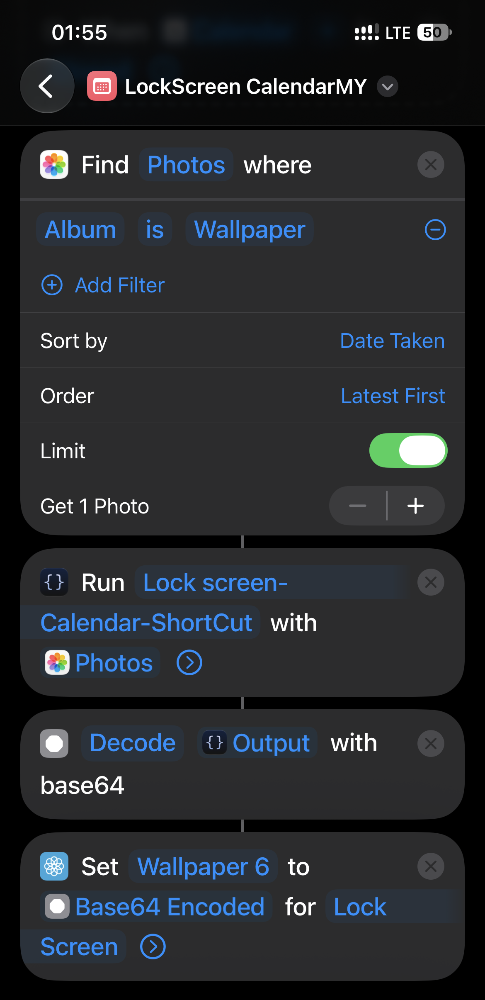
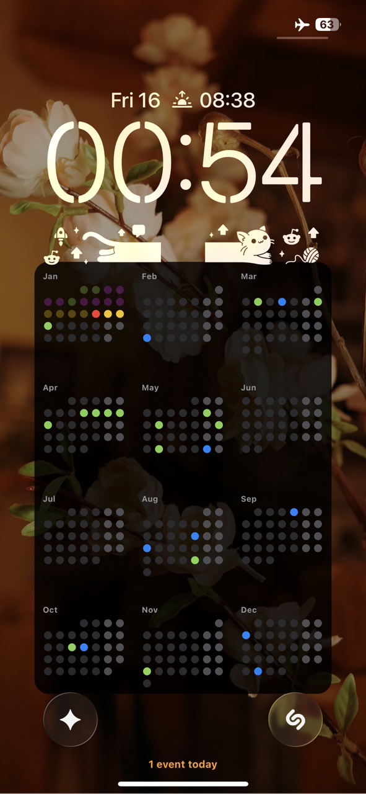

# LockScreen Calendar Shortcut

This script for the Scriptable app generates minimalistic wallpapers for iPhone featuring a yearly calendar, event display, and current year progress.

## Description

The script automatically scans your iOS calendars, filters them by a special prefix (or you can add them manually in script itself), and displays events on a yearly grid on your lock screen. Event colors are taken directly from iOS Calendar settings. It supports custom wallpapers from your Photos album, beautiful gradients, or clean solid colors.

<p align="center">
  
  
  <br/>
  
  
</p>

## Features

- **Auto-Adaptation**: Adapts to your iPhone's screen size.
- **Native Colors**: Uses colors set in the Calendar app.
- **Filtering**: Displays only calendars with a specific prefix (default `*`), or you can add them manually in script itself to keep the screen uncluttered.
- **Event Priority**: When events overlap, priority is determined alphabetically by calendar name or randomly (in case of manually added calendars priority is determined by order in script).
- **Backgrounds**:
  - **Custom Photos**: Use any photo from your library as a background.
  - **Gradients**: Use stylish CSS-like linear gradients (3 colors).
  - **Solid Colors**: Minimalist solid background.
- **Legibility**: "Container" card option to ensure calendar is readable on any background.
- **Statistics**: Shows events count or year progress.

## Installation and Setup

### Option A: Using Scriptable App (Recommended)
1. Install [Scriptable](https://apps.apple.com/us/app/scriptable/id1405459188) from the App Store.
2. Create a new script in Scriptable, name it `LockScreenCalendar`, and paste the code from `script.js` into it.
3. In iOS settings (Calendar), rename existing calendars that you want to display by adding `*` to the beginning (e.g., `*Work`) or add them manually in script.

### Option B: Paste Directly in Shortcuts
1. You can skip creating a file in Scriptable and paste the entire code directly into the **Run Script** action in Shortcuts.

---

### Shortcuts Workflow Setup

> [!IMPORTANT]
> **iOS 27.2+ / script v33+:** the script now returns the image as a **Base64 string** instead of a temporary file path (newer iOS sandbox rules no longer let Shortcuts read Scriptable's temp files). Your Shortcut needs a **Base64 → Decode** step before **Set Wallpaper** — see step 3 below. If you're updating from an older version, add that step and re-select the image in Set Wallpaper.

#### 1. Basic Setup (Solid Color / Gradient)
1. Create a new Shortcut.
2. Add **Run Script** action (Scriptable). Select your script (or paste code).
3. Add **Base64 Encode** action right after **Run Script** (search "Base64" in the actions bar).
   - Tap **Encode** and change it to **Decode**.
   - Input: "Output" (the result of Run Script).
4. Add **Set Wallpaper** action.
   - Image: Select "Base64 Encoded" (the result of the Decode step).
   - Screen: "Lock Screen".
   - **Disable "Show Preview" and "Crop to Subject"**.
- For a gradient background, set `showWallpaper: false` and `useGradient: true` in the script. For a solid color, set both to `false` (color is `colors.bg`).

#### 2. Using Custom Wallpaper (Photos)
To use a random photo from an album as a background:

1. Create an album in Photos (e.g., "Wallpapers").
2. In Shortcuts, add **Find Photos** action at the very top.
   - Filter: **Album is "Wallpapers"**.
   - Sort by: **Random** (new photo every run) — or **Date Taken / Latest First** to always use the newest photo, as in the screenshot below.
   - Limit: **Get 1 Photo**.
3. In the **Run Script** action:
   - Tap and hold the **Parameter** field (it might say "Input" or be empty).
   - Select **Photos** (the output from the first step).
4. In the script `CONFIG`, ensure:
   ```javascript
   showWallpaper: true
   ```

Full Shortcut (iOS 27.2+): **Find Photos → Run Script → Decode Base64 → Set Wallpaper**



### Automation
To update daily:
1. Open the **Automation** tab in Shortcuts and tap **+** (New Automation).
2. Select **Time of Day** (e.g., 08:00), set it to repeat **Daily**.
3. Choose **Run Immediately** and turn off **Notify When Run** so it happens in the background.
4. Select your shortcut (or add a **Run Shortcut** action pointing to it).



## Configuration

Customize `CONFIG` at the top of the script:

```javascript
const CONFIG = {
  // --- 1. GENERAL & APPEARANCE ---
  monthsToShow: 12,        // 12 = Year, 3 = Quarter, 1 = Month
  monthsPerRow: 3,         // Standard is 3
  monthOffset: 0,          // Start from 0 = Current, -1 = Previous, 1 = Next
  contentScale: 1.0,       // Global Scale Multiplier (>1.0 bigger, <1.0 smaller)
  fixedYear: true,         // If true: 12 months -> Jan..Dec; 6 months -> Jan..Jun or Jul..Dec

  // Day & Dot Settings
  showDayNumbers: false,   // true = numbers, false = dots
  firstDayOfWeek: 1,       // 0 = Sunday, 1 = Monday
  highlightWeekends: true,
  dimPastDays: true,       // If true, past days are 30% opacity
  dayFontSizeMultiplier: 1.1, // Font size for days
  dotSizeMultiplier: 1.1,  // Only applies if showDayNumbers is false

  // --- 2. BACKGROUND SETTINGS ---
  // Custom Wallpaper (Photo from Shortcuts)
  showWallpaper: true,     // Priority 1: Use photo if provided
  overlayOpacity: 0.3,     // Darken photo (0.0 - 1.0)

  // Gradient (Priority 2: Used if no photo or showWallpaper=false)
  useGradient: true,
  gradientColors: ["#0F2027", "#203A43", "#2C5364"], // Example: "Moonlit Asteroid"

  // Container (Card behind calendar for better visibility on wallpaper)
  showContainer: true,
  containerOpacity: 0.80,
  containerRadius: 15,

  // --- 3. LAYOUT & WIDGETS ---
  // Avoid Widget Areas?
  widgetsTop: false,
  topWidgetsPadding: 0.36,    // 0.36 = 36% of screen height
  widgetsBottom: false,
  bottomWidgetsPadding: 0.17, // 0.17 = 17% of screen height

  // --- 4. DATA & CALENDARS ---
  calendarPrefix: "*",
  // specificCalendarNames: ["Work", "Home"], 
  specificCalendarNames: [],

  // Manual Dates ["MM-DD"]
  manualSignificantDates: [],

  // Event Sorting
  sortByName: true, // true = Alphabetical, false = System order

  // --- 5. STATISTICS ---
  showStats: true,
  statsMode: "events", // "progress" or "events" // year progress or # events today

  // --- 6. COLORS / 7. INTERNAL RATIOS ---
  // ... see script.js
};
```
